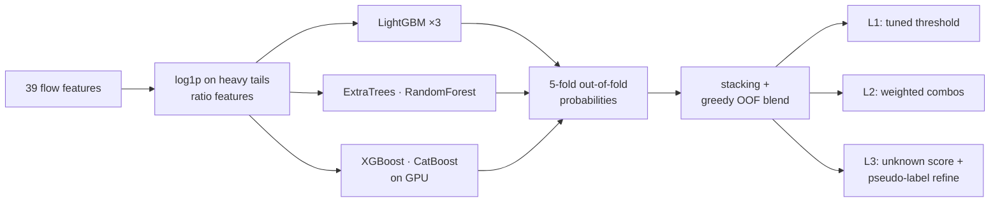

<div align="center">

# 🛡️ AI Cyber Defense Challenge: Team Eunoia

**ZTS XIII · OSACE · 8 November 2026**

Network intrusion detection in three levels: binary detection, attack-family classification and open-set detection of attacks never seen in training.


</div>

---

## 🏆 Results

| Level | Task | Metric | Best live score |
|:-:|---|---|:-:|
| **1** | Attack or normal traffic | F1 | **95.88%** |
| **2** | Which of 10 attack families | macro F1 | **61.17%** |
| **3** | 7 known families + `Unknown` for unseen attacks | 0.6 · macro F1 + 0.4 · AUROC | **83.94%** |

**1st place** on the live leaderboard at the end of the day, with a total of 62.71% (the report score was added later).
Every submission is logged with its file, settings, CV and live score in [`submissions/attempts.md`](submissions/attempts.md).

## 💡 Approach



<details open>
<summary><b>Level 1: binary detection</b></summary>

A greedy blend chosen on out-of-fold predictions: two ExtraTrees variants and a large LightGBM, with the decision threshold tuned for F1 (0.475).
Cross-validation (0.9579) matched the live score (0.9588) almost exactly, so we trusted CV from then on.
</details>

<details open>
<summary><b>Level 2: 10 attack families</b></summary>

Seven base models (three LightGBM settings, ExtraTrees ×2, RandomForest, XGBoost), stacked with a meta-model.
The final file mixes stack ×2, LightGBM and ExtraTrees.
The ceiling is in the data: Exploits, DoS, Analysis and Backdoor rows share identical byte values (leave-one-out accuracy 47% among them), which holds macro F1 near 0.61.
</details>

<details open>
<summary><b>Level 3: open set</b></summary>

- **Known classes:** the stack of LightGBM, ExtraTrees, RandomForest, XGBoost-GPU and CatBoost-GPU, blended with LightGBM and ExtraTrees.
- **`unknown_score`:** a rank blend of prediction entropy, kNN distance to the training data and an adversarial train-vs-test classifier. It was validated by hiding one known class at a time (leave-one-class-out AUROC 0.88).
- **Refine (the biggest gain, 0.758 → 0.839):** the most suspicious 8–16% of test rows are pseudo-labelled `Unknown` and the model is retrained, so it learns what "new" looks like in this test set.
- **Eight-class model:** a LightGBM with an explicit pseudo-`Unknown` class, mixed in at 30%. Best score: 0.8394.
</details>

## 🗂️ Repository

```
src/
  solve.py         single-model baseline for any level + output checks
  multi.py         train many models with 5-fold OOF, combos and blends
  stack.py         meta-model on OOF probabilities
  l1_plus.py · l1_more.py · l1_blend.py    level 1 variants and greedy blend
  l3_eight.py · l3_ensemble.py · l3_*.py   level 3 open-set experiments
  check_l3.py      CSV format check before upload
  score.py · make_mock.py                  local scorer and mock data for the dry run
submissions/attempts.md                    every upload, settings and score
Raport_tehnic_ZTS2026_Eunoia.pdf           technical report (Romanian, 3 pages)
```

## ▶️ Reproduce

```bash
python -m pip install -r requirements.txt
# put level{N}_train.csv and level{N}_test.csv from the platform into data/
```

<details>
<summary><b>Level 1</b> → 95.88%</summary>

```bash
python src/l1_plus.py --data data --out submissions_l1x --variants base,big
python src/l1_more.py --data data --out submissions_l1x --models et2,rf,hgb,cat,xgb
python src/l1_blend.py --data data --dir submissions_l1x          # → level1_blend.csv
```
</details>

<details>
<summary><b>Level 2</b> → 61.17%</summary>

```bash
python src/multi.py train  --level 2 --data data --out submissions_l2x --models lgb,et,rf,lgb2,lgb3,xgb,et2
python src/stack.py        --level 2 --data data --out submissions_l2x --models lgb,et,rf,lgb2,lgb3,xgb,et2
python src/multi.py combos --level 2 --data data --out submissions_l2x --combos "stack+stack+lgb+lgb+et"
```
</details>

<details>
<summary><b>Level 3</b> → 83.94%</summary>

```bash
python src/multi.py train  --level 3 --data data --out submissions_l3x --models lgb,et,rf,xgbg,catg   # xgbg/catg need an NVIDIA GPU
python src/stack.py        --level 3 --data data --out submissions_l3x --models lgb,et,rf,xgbg,catg
python src/multi.py blend  --level 3 --data data --out submissions_l3x --fixed "stack+stack+lgb+lgb+et"
python src/solve.py --level 3 --data data --out submissions_l3x/sub --probs submissions_l3x --refine --refine-frac 0.12
python src/l3_eight.py --data data --probs submissions_l3x \
       --sub submissions_l3x/sub/level3_submission_refine12x1.csv \
       --out submissions_l3x/sub/level3_submission_eight.csv
python src/check_l3.py submissions_l3x/sub/level3_submission_eight.csv data/level3_test.csv
```
</details>

Training ran on a lab PC with 28 CPU cores and an RTX 4070. A full level 2 round takes about 25–30 minutes.

## 👥 Team

**Eunoia**: Drangoi Karina · Secrieru Maxim. Technical University of Moldova (UTM).

AI was used to structure the code and the report.
